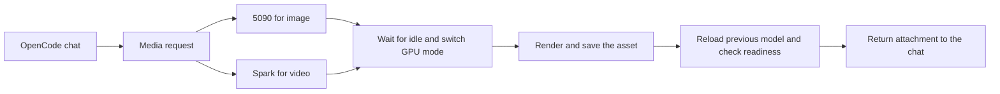

# Fast local Qwen and media generation on an RTX 5090 and DGX Spark

We use two GPUs to run local models from one OpenCode workspace. An RTX 5090 serves Qwen3.8-27B and switches to image generation when needed. A DGX Spark serves the larger Qwen3.8-Flash-Next with a 262,144-token context and switches to video generation. A chat can call the other machine’s media model, receive the finished asset, and keep its conversation intact.

These machines solve different problems. The 5090 is the fast interactive model. Spark gives us room for a much larger checkpoint and long prompts. When either machine needs its GPU for media, we swap the serving process and keep the application session.

# Making the 27B model fast on one 5090

Our target is the community abliterated Huihui Qwen3.8-27B in Q4_K_M GGUF, served by tqLLM 1.4.4. Abliteration is a modification to the model weights intended to reduce refusal behavior. The server holds the conversation’s attention keys and values in an 8-bit KV cache and exposes a 204,800-token context.

The largest decode gain came from DFlash2. A small TQ3 drafter proposes a block of tokens in parallel. We cap it at seven proposals per verification pass and use a 65,536-entry draft vocabulary. The 27B target checks the proposed tokens and commits the verified prefix. When the draft gets several tokens right, the target can advance the conversation by several tokens per verification pass. The target checkpoint still decides what to emit. [DFlash paper](https://arxiv.org/abs/2602.06036) · [DFlash2 model card](https://huggingface.co/z-lab/Qwen3.8-27B-DFlash2)

In a controlled test on the same 5090, we held the target weights, Q8 KV cache, and 40,960-token configured context fixed. Across two greedy coding prompts capped at 512 output tokens, median decode rose from **82.3 to 292.5 tokens per second** with DFlash2. Both output pairs matched byte for byte. On the separate 204,800-token serving profile, one 2,048-token coding run reached **274.4 tok/s** and one reasoning run reached **310.5 tok/s**. The reasoning run used a 1,024-token thinking budget.

Decode speed describes what happens after the model starts writing. On that same serving profile, a cold 33.5K-token prompt still took **12.9 seconds** to reach the first token. For an agent that repeatedly reads large codebases, processing the input can dominate the time the user waits.

# Giving the larger model a long context on Spark

Spark runs the Swift-derived, community abliterated Huihui Qwen3.8-Flash-Next IQ3_S checkpoint. Its unified memory holds all 512 experts per layer resident for decode. The model routes each token to a subset of those experts. Native multi-token prediction proposes future tokens, and the target verifies them. This deployment uses the Flash-Next IQ4 MTP drafter. [tqLLM model and format support](https://tqllm.com/models) · [Flash-Next MTP assets](https://huggingface.co/YTan2000/Qwen3.8-Flash-Next-tqLLM)

| Serving profile | Coding decode | Reasoning decode | First token on a cold 33.5K prompt |
| --- | ---: | ---: | ---: |
| RTX 5090 · Qwen3.8-27B · 204,800 context | 274.4 tok/s | 310.5 tok/s | 12.9 s |
| DGX Spark · Qwen3.8-Flash-Next · 262,144 context | 66.5 tok/s | 59.9 tok/s | 17.8 s |

These are one-stream serving probes. Each decode cell is one capped 2,048-token run. Both machines also returned the expected key from a 100,313-token prompt.

Spark exposed a second source of latency. Our server configuration enabled prefix caching, but tqLLM v1.4.4 gated it on having more than one slot. Our single slot therefore recomputed a shared 16K-token prompt prefix on each follow-up. In an isolated build, we enabled single-slot reuse and moved a sparse-attention scratch allocation outside CUDA graph capture. Follow-ups went from **8.21 seconds to 0.23 seconds** to the first token, reusing about 99.5% of the prompt. Sustained decode changed by about 2% or less. Four of six sustained greedy outputs differed across builds, and we returned the live server to stock. In a follow-up test on two prompts, the graph change alone matched stock across both 1,536-token outputs. The cache change alone diverged with zero reused tokens, pointing to the prefill pass that creates the cache snapshot. Changing the size of a prefill chunk can change floating-point rounding. If that flips the highest-scoring token, the model’s subsequent input changes. [tqLLM v1.4.4 cache implementation](https://github.com/turbo-tan/tqllm/blob/v1.4.4/src/models/qwen/qwen4exp/fn_engine.hpp)

# Switching from chat to image or video

OpenCode exposes image and video tools over MCP. An image request goes to the 5090, which runs Qwen Image 2.1 Turbo. A video request goes to Spark, which runs MiniMax H3 through ComfyUI. The calling chat can be on either machine.

The controller checks that chat is idle before unloading it and takes a host-level lock during the switch. It records the previous mode, waits for the media engine to become ready, and saves the finished artifact before restoring the previous model. When rendering fails, it attempts to restore the previous mode and records whether restoration succeeded. Conversation history stays in OpenCode, so loading a model again does not erase the conversation. The GPU is occupied during rendering, and loading chat again adds a cold-start delay.

In an end-to-end smoke test, a Spark chat sent a 512×512 image request to the 5090 and received a PNG of a red origami fox. A 5090 chat sent a two-second video request to Spark and received an MP4 of a yellow paper boat. Both attachments downloaded successfully, and both chat servers answered a fresh inference request after restoration. These tests exercised the switching and delivery path at small resolutions.

The delivery presets separate what the models generate from what the user receives. A square image renders at 2,048×2,048 and can be resized to a 4,096-pixel edge. The high video preset renders at 1,920×1,088, crops to 1,920×1,080, and upscales to 3,840×2,160. Longer videos are assembled from clips sized to fit Spark’s memory.

# What we measure before changing a serving profile

We treat prompt processing, decode, and model switching as separate measurements. A draft model can speed up generation while leaving cold prompt latency unchanged. Prefix reuse can remove seconds from a follow-up with little effect on tokens per second. And a media job is only useful in the conversation once the attachment can be read and the chat service can answer again. Measuring each part tells us which change will make the next interaction faster.
