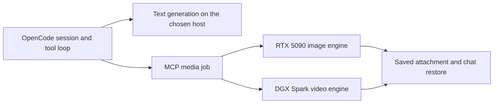

# What makes a local agent fast enough to use?

The largest speedup in Strata changed how long we waited for a reply to **start**. On Spark, median time to first token across four OpenCode follow-ups fell from **5.60 seconds to 0.52 seconds** when we made prefix reuse work. On the 5090, DFlash2 shortened a different part of the turn. It raised median decode from **82 to 292 tokens per second** in two matched coding probes while cold prompt processing still took seconds.

That difference matters because the unit of work is a turn in an ongoing conversation. A turn can reopen a large repository context, run a tool, or ask another machine to render an asset. A faster decoder only shortens part of that path.

This is a systems companion to my Collective Intelligence series. In [One Harness, Six Ways to Work](https://macoredroid.github.io/collective-intelligence/part-8/), I held the harness fixed and looked at how different models coordinated. Here I held the checkpoints fixed within each comparison and looked at where the harness spent time, what state it preserved, and what happened when a GPU changed jobs.

# What Strata owns

Strata is my local workspace for model serving, conversations, and media jobs. OpenCode owns the conversation and tool loop. The inference process owns the transient model state, including attention caches. A separate controller owns GPU mode changes and the media job record. On mobile I can resume a conversation on its owning host, follow tool activity, and download the returned attachment.

The split grew out of a practical constraint. The same GPU that answers a chat might be needed to render the next artifact. If the conversation lived only inside the inference process, freeing GPU memory would also break the user's flow. Keeping messages and tool results in the harness lets the next request rebuild the context after the model comes back. The same separation lets us replace a serving engine without migrating conversation history.

**Strata** here names the workspace. We also tried the upstream [Strata inference engine](https://github.com/Niko1221/Strata) in earlier runs. Both of the chat profiles described below use [tqLLM 1.4.4](https://tqllm.com/releases). The measured speedups belong to specific checkpoint, engine, and drafter combinations.



# Two GPUs, two inference paths

| Layer | RTX 5090 | DGX Spark |
| --- | --- | --- |
| Target | Huihui Qwen3.8-27B abliterated UD-DW Q4_K_M | Huihui Qwen3.8-Flash-Next abliterated v2, Swift IQ3_S |
| Drafting | TQ3 DFlash2, seven proposals, 65,536-token draft vocabulary | IQ4 native MTP, adaptive drafts up to seven |
| Context | 204,800 tokens with Q8 KV | 262,144 tokens with one slot |
| Media role | Qwen Image 2.1 Turbo | MiniMax H3 through ComfyUI |

Abliterated checkpoints are community derivatives with weight changes intended to reduce refusal behavior. Quantization choices belong to the serving profile too. For example, the 5090 uses an 8-bit cache for the attention keys and values so that the 27B weights, draft model, and long context can fit together. We measured the effect of adding the drafter with the target GGUF and KV format held fixed.

On the **5090**, a small block diffusion model proposes several tokens in one pass. The 27B target verifies the proposed block and advances by the accepted prefix. A smaller draft vocabulary cuts the drafter's work, while verification uses the target's own scores. This makes output speed depend on how many proposals the target accepts and how much each round costs. [DFlash paper](https://arxiv.org/abs/2602.06036) · [DFlash2 checkpoint](https://huggingface.co/z-lab/Qwen3.8-27B-DFlash2)

On **Spark**, Flash-Next routes each token to a subset of its experts. Unified memory lets this profile keep all 512 experts per layer resident for decode, so choosing a different expert does not require moving its weights in from a host cache. The native multi-token prediction head supplies drafts. Its confidence cutoff controls how long the engine keeps proposing tokens before the target verifies them. The launch manifest ties together two target shards, the MTP weights, a tokenizer, and the draft vocabulary. [Flash-Next serving assets](https://huggingface.co/YTan2000/Qwen3.8-Flash-Next-tqLLM)

# What the experiments changed

**1. Drafting is a large lever when acceptance and verification cost line up.** In two greedy coding probes capped at 512 output tokens, the 5090 went from **82.3 to 292.5 tok/s** with DFlash2. The target, Q8 KV, and 40,960-token configured context were fixed. Both output pairs matched exactly. The separately configured 204,800-token profile reached **274.4 tok/s** on one capped coding run and **310.5 tok/s** on one reasoning run. A cold 33.5K prompt on that profile still took **12.9 s** before the first token.

**2. A cache setting needs a counter.** Stock tqLLM 1.4.4 accepted the prompt-cache option on Spark, but its Flash-Next engine required more than one slot before reusing prompt state. The two stock follow-ups reused zero tokens. In a combined patch trial, Spark reused about **99.5%** of each 16K prefix. Median first-token latency fell from **8.21 s to 0.23 s**. The identical cold prompt went from **8.22 s to 8.81 s**. The fast path depends on an actual shared prefix and a retained snapshot. After a model switch or restart, the first turn has to populate the cache again. [tqLLM 1.4.4 cache implementation](https://github.com/turbo-tan/tqllm/blob/v1.4.4/src/models/qwen/qwen4exp/fn_engine.hpp#L68-L75)

Flash-Next mixes sparse attention with recurrent layers. To resume, the engine restores the recurrent state, convolution history, and per-layer embedding state from a snapshot near the end of the previous prompt. It rewinds the attention and drafter caches to that position, then processes the new suffix. OpenCode can reconstruct the conversation from disk, but only the running model process holds this snapshot. In one slot, the next unrelated request can replace it. [Snapshot and restore code](https://github.com/turbo-tan/tqllm/blob/v1.4.4/src/models/qwen/qwen4exp/fn_engine_prefill.cpp)

I checked whether that improvement survived an actual harness. Two three-turn OpenCode chats used Python standard-library source and then asked questions that depended on the earlier turn. Both profiles answered all six checks correctly. The patched server reused **8,577–11,846 tokens** per follow-up and zero on each fresh chat. The cold first turns got slower, from **6.27 to 8.12 s** and **4.88 to 5.27 s**. I named the test sessions explicitly and disabled tools for this comparison. OpenCode's automatic title generation otherwise sends its own model request, which makes a single-slot measurement hard to interpret.

**3. Greedy output is a numerical test.** The combined patch initially changed four of six long greedy outputs. When we isolated the changes, the CUDA graph fix matched stock on both 1,536-token samples. The cache change alone diverged at tokens **38** and **27** with zero cache hits. The second split occurred below the sparse-attention threshold. Creating the snapshot adds a prefill chunk boundary, which can change floating-point rounding. A close token choice can then flip, and the next prediction sees a different history. We measured the first divergent token, while the score margin between the two choices remains unknown. This is why we check task outcomes on actual follow-up turns as well as exact token matches on controlled runs.

**4. Draft tuning helped on Spark, but the gain was smaller.** With the cache and graph patches disabled, moving the MTP confidence cutoff from 0.90 to 0.80 moved **68.3 → 71.5 tok/s** on one short prompt and **65.6 → 66.6 tok/s** on one 15.6K prompt. Both holdout outputs matched stock across all 1,536 tokens. The larger published **122 tok/s** result uses tqLLM's own mixed-quantization checkpoint. That gives us a lead for a different profile, while the numbers above isolate a setting on our existing abliterated weights. [tqLLM 1.4.2 release measurements](https://tqllm.com/releases)

A follow-on decode experiment could keep the same target shards and try DFlash2 for Flash-Next in llama.cpp. The recent support change averages Flash-Next's four residual streams before exposing the hidden states to the drafter. A separate Swift 1.5 test on an M5 Max reported **+12% on code and −2% on prose** at a 163,840-token configured context using a different quantization. On our hardware, I would run the same target and prompts with native MTP and DFlash2 in the new engine, then compare the winner against the current tqLLM setup. [llama.cpp feature capture change](https://github.com/ggml-org/llama.cpp/pull/30927) · [Swift 1.5 drafter measurements](https://huggingface.co/nazeshinjite/Qwen3.8-Flash-Next-DFlash2-GGUF#fine-tunes-of-the-same-base-drafter-unchanged)

| Serving profile | Coding decode | Reasoning decode | First token on a cold 33.5K prompt |
| --- | ---: | ---: | ---: |
| 5090, 204,800-token configuration | 274.4 tok/s | 310.5 tok/s | 12.9 s |
| Spark, 262,144-token configuration | 66.5 tok/s | 59.9 tok/s | 17.8 s |

Each decode cell is a single 2,048-token capped run. The reasoning probes used a 1,024-token thinking budget. Both models also returned the expected key from a 100,313-token input. A configured context limit describes the serving envelope, while the retrieval probe checks one concrete behavior within it.

# Switching a GPU without losing the conversation

A media tool submits a job to the host that owns the corresponding model. The controller waits for idle chat, records the previous mode, and takes a host lock before unloading the model. It checks that the new engine is ready, renders and saves the output, then restores the previous model. The job records errors and whether restoration succeeded. User intent to stop a model survives this cleanup.

I tested this with a Spark chat requesting a 512×512 origami fox from the 5090, and a 5090 chat requesting a two-second paper boat clip from Spark. Both attachments downloaded and both restored chat engines answered a fresh request. Those small renders exercised routing, switching, saving, and resuming the conversation. The production delivery presets render a square image at 2,048 pixels and upscale it to 4,096, or render video at 1,920×1,088, crop to 1,920×1,080, and upscale to 3,840×2,160. Longer videos use clips sized to fit available memory.

For a one-machine version, put both modes behind the same controller. Keep the messages and job record on disk, serialize GPU ownership, and give each transition a readiness check and a timeout. Test failure during model startup as well as a successful render. Measure the time until chat can answer again, since that is part of the cost of sharing a GPU.

# Try the serving profiles on your hardware

Start with the text server on one machine. The recipes use Linux, Docker, NVIDIA drivers with container GPU access, and the public tqLLM 1.4.4 image. Use an RTX 5090-class 32 GB GPU for the 27B settings below, or a 128 GB GB10 Spark for the Flash-Next settings. Set aside roughly **20 GB** or **90 GB** of SSD space respectively for the pinned model assets, plus room for the container image. Check GPU access before downloading. Spark's script uses CDI, and the 5090 script uses Docker's NVIDIA runtime. [NVIDIA container setup](https://docs.nvidia.com/datacenter/cloud-native/container-toolkit/latest/install-guide.html) · [tqLLM installation](https://tqllm.com/install)

```bash
git clone https://github.com/MaCoredroid/strata-local-inference.git
cd strata-local-inference

# Choose one profile on its own host.
bash recipes/serve.sh 5090
# Or, on a 128 GB GB10:
bash recipes/serve.sh spark
```

The [serving script](recipes/serve.sh) pins each public asset to a revision and verifies its SHA-256 before launch. It writes the Spark manifest and binds the API to loopback. The public recipe starts the stock release, so a stock single-slot Spark run is the baseline for the cache exercise below. Set `STRATA_MODEL_DIR` to an SSD directory, add `--download-only` to stage weights without starting a GPU process, and set `STRATA_PORT` if 8144 is in use. If the profile does not fit your card, start with a model or context that fits and record that as a separate configuration.

From a second terminal, confirm the model and context before timing anything.

```bash
base=http://127.0.0.1:8144
curl -fsS "$base/v1/models"
curl -fsS "$base/api/monitor/v1/snapshot" | jq '.engine'
```

Then connect an OpenAI-compatible client to `http://127.0.0.1:8144/v1` and choose `strata-27b` or `strata-flash-next` as the model ID. To run the client from another machine, forward the loopback port with SSH. Leave the API bound to loopback on the serving host.

```bash
# On the client machine. Replace spark-host with your SSH host.
ssh -NT -o ExitOnForwardFailure=yes -L 127.0.0.1:18145:127.0.0.1:8144 spark-host
```

For OpenCode 2, start with a separate config directory so you can try the provider without changing your existing defaults.

```bash
export XDG_CONFIG_HOME="$(mktemp -d)"
mkdir -p "$XDG_CONFIG_HOME/opencode"
# Save the JSON below as "$XDG_CONFIG_HOME/opencode/opencode.json".
```

Use port 8144 when running on the same machine. For the 5090 recipe, use its forwarded port, set `modelID` to `strata-27b`, and set `context` to 204800.

```json
{
  "$schema": "https://opencode.ai/config.json",
  "model": "strata/local",
  "providers": {
    "strata": {
      "name": "Strata local",
      "package": "@opencode/ai/providers/openai-compatible",
      "settings": { "baseURL": "http://127.0.0.1:18145/v1" },
      "models": {
        "local": {
          "name": "Local Qwen",
          "modelID": "strata-flash-next",
          "limit": { "context": 262144, "output": 32768 },
          "capabilities": { "input": ["text"], "output": ["text"], "tools": true },
          "compatibility": { "reasoningField": "reasoning_content" },
          "body": { "cache_prompt": true }
        }
      }
    }
  }
}
```

```bash
opencode run --standalone --model strata/local --title "Local check" \
  "What is 17 times 19? Answer with only the integer."
```

1. **Measure prefill and decode separately.** Use one stream and record prompt and output token counts, time to first token, and decode tok/s. Try short and long prompts at the same output cap. Keep the task, temperature, context and target fixed when comparing drafters.
2. **Use real follow-ups.** Paste a source file or design note into a conversation and include a fact you can verify. Ask two later questions that depend on it, in the same session. Then try a separate conversation and confirm the previous prefix was not reused. For a controlled OpenCode CLI test, give the first `opencode run` an explicit `--title` and reuse its session ID for subsequent turns. The default title generator sends its own inference request and can confuse the timing comparison or displace a single-slot snapshot.
3. **Inspect the counters.** The monitor gives per-request prompt, cached, and output tokens. A fast second reply alone can come from a short answer or a warmed process. Pair the cache counter with first-token time and repeat the run.
4. **Expand the test after it works.** Try your usual reasoning mode and a real tool loop. If you add media, time job completion and the first successful chat reply after the mode switch. Use the same saved model identity on both sides of that check.

```bash
curl -fsS "$base/api/monitor/v1/snapshot" | jq '.requests[-1] | {
  prompt_tokens, prefill_cached_tokens, output_tokens,
  first_output_ms, decode_tokens_per_second
}'
```

## Reproduce the Spark cache comparison

The [optional Spark patch](recipes/tqllm-spark/followup.patch) enables single-slot reuse on unified memory and sets the adaptive MTP cutoff to 0.80. It grows the KV allocation in 16,384-token increments as requests need room, with the same 262,144-token limit. The CUDA graph experiment is separate. The patched build used CUDA Toolkit 13.0 on ARM64 GB10. From the guide's checkout, with a C++ compiler, CMake, and the CUDA toolkit installed:

```bash
git clone --branch v1.4.4 https://github.com/turbo-tan/tqllm.git tqllm-src
git -C tqllm-src apply --check "$PWD/recipes/tqllm-spark/followup.patch"
git -C tqllm-src apply "$PWD/recipes/tqllm-spark/followup.patch"
cmake -S tqllm-src -B tqllm-src/build -DCMAKE_BUILD_TYPE=Release \
  -DTQLLM_CUDA=ON -DCMAKE_CUDA_ARCHITECTURES=121
cmake --build tqllm-src/build --target tqserve --parallel 6

# Stop the stock test server first. This reuses the same model directory.
STRATA_TQSERVE_BINARY="$PWD/tqllm-src/build/tqserve" bash recipes/serve.sh spark
```

Repeat the same turns with the same model directory, one slot, and the same configured context. Verify that fresh chats start with zero cached tokens. Compare cold turns and follow-ups separately, and check whether the answers still satisfy the task. To rerun stock, stop the test server and launch the recipe without the binary override.

The most useful next comparison is a repeated turn from your own workload. It will tell you whether to spend your time on a better drafter, a working prompt cache, or a shorter restart.
